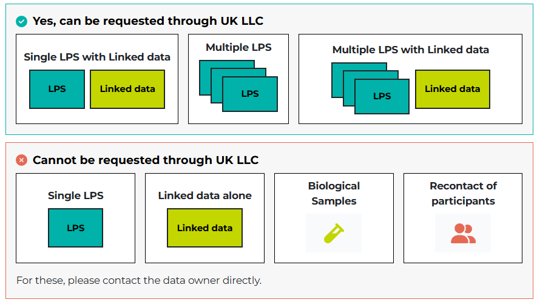

# Applying to UK LLC
>Last modified: 12 Nov 2026

<strong>UK LLC welcomes applications from eligible researchers.</strong>

 

To ensure the appropriate and fair use of LPS participants’ information, UK LLC operates a rigorous **multi-stage application review process**. All applicants and their applications are assessed against the [**Five Safes Framework**](https://ukdataservice.ac.uk/help/secure-lab/what-is-the-five-safes-framework/) to determine if the application meets the requirements and commitments agreed with participants of the partner LPS and linked data owners.  

<aside class="admonition note">
All projects <b>must</b> include data from at least one of UK LLC's partner LPS.
UK LLC does not enable access to linked data (e.g. electronic health records) alone.</a></aside>  

As summarised in the diagram below, you can apply to UK LLC to access data from **multiple LPS**, or one or more LPS in **conjunction with linked data**. If you require non-linked LPS data from one LPS only, please contact that LPS directly. If you require access to linked data only (e.g. NHS data), please contact the linked data owner directly.

