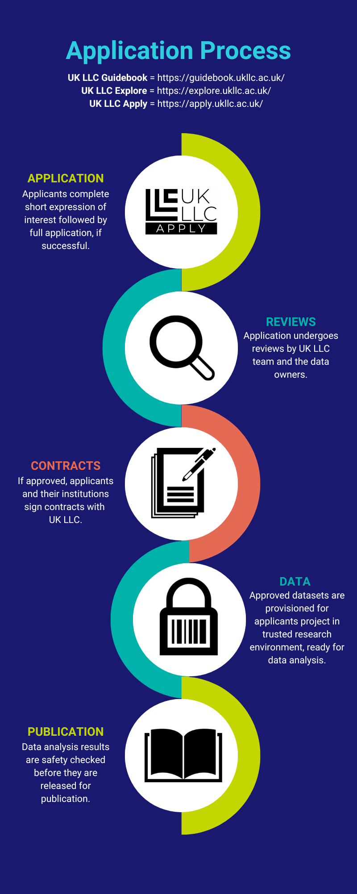

# Application process
>Last modified: 12 Nov 2026

<strong>The diagram summarises the researcher journey from application to data provision to publication of analyses.</strong>

 

See the diagram below and the various guides in this section for detailed information about UK LLC's application process. If approved, applicants and their organisations must sign contracts with UK LLC, before they are provisioned data for their project within the UK LLC TRE. Safety-checked results of data analyses can be used for publications. Take a look at the [**UK LLC Data Use Register**](https://ukllc.ac.uk/data-use-register) to see a list of applications already submitted to UK LLC. To understand how to request file outs from the TRE and how to publish your research, browse the [**TRE user guide**](../../user_guide/introduction.md). 

