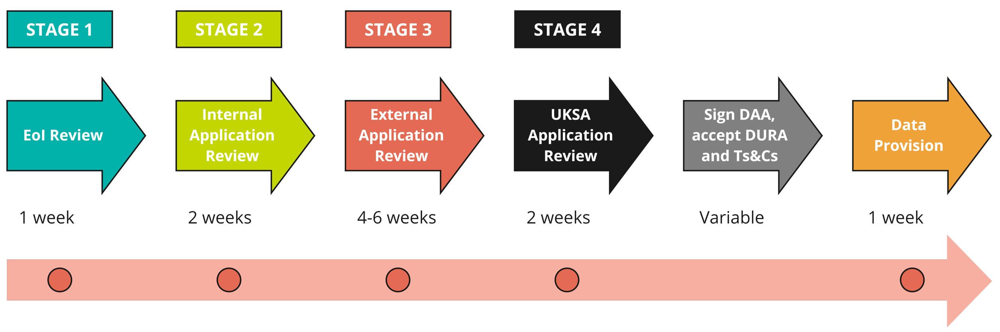

# How long does it take?
>Last modified: 12 Nov 2026

<strong>From application to data provision takes at least 12 weeks, so researchers need to give themselves enough time.</strong>

 

**Figure 1** A summary of UK LLC's application process with **approximate timings** for each stage - also see the metrics below

**EoI**: Expression of Interest; **UKSA RAP**: UK Statistics Authority Research Accreditation Panel.

**Notes**: 
- The timeline does not reflect the time spent working with the researcher on revisions
- Only applications that include [**non-health administrative data**](../../linked_admin_data/admin_data.md) need to go through Stage 4 review by the UK Statistics Authority
- The time it takes for a researcher’s organisation to sign a Data Access Agreement with UK LLC can vary between less than a month to several months – this is outside the control of UK LLC - see the [**Contracts guide**](../applying/paperwork.md) for further information.

<aside class="admonition note">
EoI metrics
On average it takes UK LLC 3.6 days to approve an expression of interest (from submission of final version of EoI).</aside> 
<aside class="admonition note">
Application metrics
On average it takes UK LLC and data owners 97.0 days to approve an application (from submission of final version of application).</aside> 
