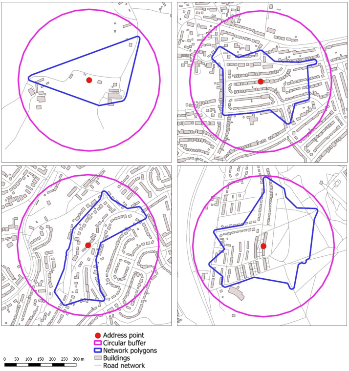

# Understanding: Greenspace metrics

>Last modified: 29 Oct 2026

<strong>The greenspace dataset from the University of Leicester includes metrics on vegetation, greenspace coverage, tree density, walkability, and the size and number of greenspaces.</strong>

 

## Introduction

Greenspace metrics have been developed by the University of Leicester for residential addresses/postcodes for cohorts partnering with UK LLC, where the appropriate permissions are in place.

Some variables cover the entire United Kingdom (UK), while others are limited to Great Britain (GB). Please refer to the table below for geographic coverage of variables:

| **Variable**     | **Description**                                                  | **Geographic Coverage** |
|------------------|------------------------------------------------------------------|--------------------------|
| S2NDVI2020       | Sentinel-2 NDVI (Normalized Difference Vegetation Index), 2020   | UK                       |
| LSNDVI2020       | Landsat NDVI (Normalized Difference Vegetation Index), 2020      | UK                       |
| LSNDVI2010       | Landsat NDVI (Normalized Difference Vegetation Index), 2010      | UK                       |
| LSNDVI2000       | Landsat NDVI (Normalized Difference Vegetation Index), 2000      | UK                       |
| LSNDVI1990       | Landsat NDVI (Normalized Difference Vegetation Index), 1990      | UK                       |
| OSGS_AREA        | Total greenspace area                                            | GB                       |
| OSGS_PCT         | Percentage greenspace                                             | GB                       |
| OSGS_MAXAR       | Largest greenspace                                                | GB                       |
| OSGS_CNT         | Number of greenspaces                                             | GB                       |
| OSGS_AP          | Number of greenspace access points                                | GB                       |
| TCD_MEAN         | Tree cover density                                                | UK                       |
| TC_PCT           | Percentage tree cover                                             | UK                       |
| IMD_MEAN         | Imperviousness degree                                             | UK                       |
| IMD_PCT          | Percentage imperviousness                                         | UK                       |
| EUDIST2NAP       | Euclidean distance to nearest access point                        | GB                       |
| NTDIST2NAP       | Network distance to nearest access point                          | GB                       |

## Methodology

Each greenspace metric is available for either circular buffers (CB – a circle around a specific address point) or network polygons (NP - given distance along a road and path network from a specific address point) for a range of distances.

Figure 1 shows example circular buffers and network polygons.

***Figure 1 : Comparison of 300m circular buffers and network polygons for randomly selected addresses in different locations***

Given that some metrics are correlated with each other, the metrics could be slimmed down to a smaller subset but it depends on the individual researcher as to whether they want to explore the full set.

#### Geocoding of participant addresses

In order to derive the environmental characteristics and exposures associated with residential locations, participant addresses were geocoded. More information on this process can be found on the Guidebook page: [Environmental Exposure](Estimates https://guidebook.ukllc.ac.uk/docs/linked_geo_data/processing/processing_and_linkage.html#environmental-exposure-estimates)

## Caveats:

- Network polygons are always smaller than circular buffers of an equivalent size. i.e. a network polygon of 300m will always be smaller than a circular buffer of 300m.

- Network polygons are substantially more complex to calculate. Hence, running network polygons for large sizes is not recommended and for distances over 2km, travel is likely to be by car/public transport instead of on foot, and hence network polygons are less likely to be significant. In contrast, for small distances usually travelled on foot, network polygons are likely to give a better representation of accessible greenspace.

- Note that these metrics have been designed for running from address points rather than generalised postcode locations. If only postcodes are available then researchers should take note of the following. In urban areas, postcode polygons are small and hence, results will not vary significantly compared with using an address point. In rural areas, postcode polygons can be very large and hence there could be some differences between an address point and the result using the postcode alone but it depends on the character and variability of the landscape.

- The Ordnance Survey provide an <a href="https://www.ordnancesurvey.co.uk/products/code-point-open" target="_blank" rel="noopener noreferrer">Open Code Point product</a> which uses the delivery point nearest to the mean of all address points within the postcode polygon. This works reasonably well as an address point substitute but will not give exactly the same as using the actual address point.
The table below gives a summary of the key greenspace metrics. This represents a core set of metrics that researchers may find most useful.

> **Note**
> Network polygons are proposed for smaller distances and circular buffers for larger ones. For larger distances of 5km and 10km, only the maximum
> greenspace size is calculated. This is because for large areas, most other metrics (e.g. NDVI, percentage greenspace) converge to a single value and
> hence variability decreases. These larger distances are only included to allow for application of
> <a href="https://publications.naturalengland.org.uk/publication/65021" target="_blank" rel="noopener noreferrer">Natural England’s ANGSt model</a> on greenspace accessibility (which uses distances of
> 300m, 2km, 5km and 10km).

| **Variable**                                 | **NP 300m** | **NP 1km** | **CB 2km** | **CB 5km** | **CB 10km** |
|---------------------------------------------|-------------|------------|------------|------------|-------------|
| NDVI Sentinel-2 2020                         | ✓           | ✓          | ✓          |            |             |
| Percentage greenspace                        | ✓           | ✓          | ✓          |            |             |
| Largest greenspace area                      | ✓           | ✓          | ✓          | ✓          | ✓           |
| Number of greenspaces                        | ✓           | ✓          | ✓          |            |             |
| Tree cover density                           | ✓           | ✓          | ✓          |            |             |
| Network distance to nearest access point     | ✓           | ✓          | ✓          |            |            |

**Table 2 – Best recommended options of greenspace metrics if exact residential locations are available (NP = network polygons, CB = circular buffer)**

- Following disclosure control checks the original environmental exposure values have been rounded prior to be made available in the UK LLC TRE. Please see Table 3 for more details.

| **Variable**                                 | **Original value** | **Value in UK LLC TRE** |
|---------------------------------------------|-------------|------------|
| LSNDVI2020                      | 4 decimal places           | 2 decimal places           |
| LSNDVI2010                       | 4 decimal places           | 2 decimal places          |
| LSNDVI2000                     | 4 decimal places           | 2 decimal places          |
| LSNDVI1990                        | 4 decimal places           | 2 decimal places          |
| S2NDVI2020                           | 4 decimal places           | 2 decimal places          |
| OSGS_AREA     | 3 decimal places           |  integer          |
| OSGS_PCT       | 6 decimal places |	2 decimal places |
| OSGS_AP        | integer |	integer |
| OSGS_CNT       | integer |	integer |
| TCD_MEAN        | 4 decimal places |	1 decimal place |
| TC_PCT          | 2 decimal places |	2 decimal places |
| IMD_MEAN        | 4 decimal places |	1 decimal place |
| IMD_PCT         | 2 decimal places |	2 decimal places |
| EUDIST2NAP      | 4 decimal places |	integer |
| NTDIST2NAP      | 4 decimal places |	integer |

**Table 3 – Original environmental exposure values for greenspace (and their attribute name) as well as the disclosure control exposure values available in the UK LLC TRE.**

## Limitations:

*  The greenspace metrics were developed for residential addresses in the Longitudinal Linkage Collaboration (LLC). These can be re-run for any cohort of participants where latitude / longitude point locations are available for participant addresses.  They can also be run for postcode mean delivery points but this approach may not be suitable for rural households as, in these cases, postcode mean points can be significant distances from specific households.

* Geocoding accuracy and completeness are dependent on the quality, completeness and specificity of the source address information, resulting in varying match confidence, positional uncertainty and a proportion of unmatched records. More information on the match success and confidence level of the geocoding used in the datasets can be found [here](https://guidebook.ukllc.ac.uk/docs/linked_geo_data/processing/processing_and_linkage.html#environmental-exposure-estimates).

## Useful Syntax

