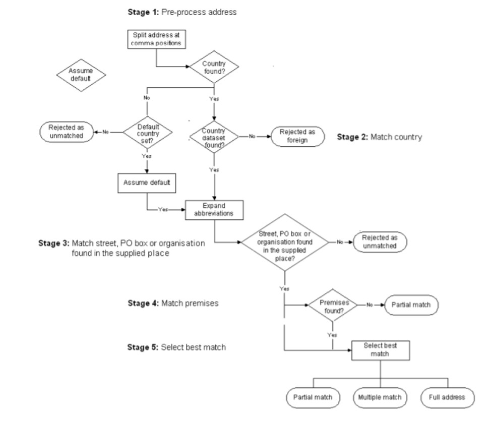
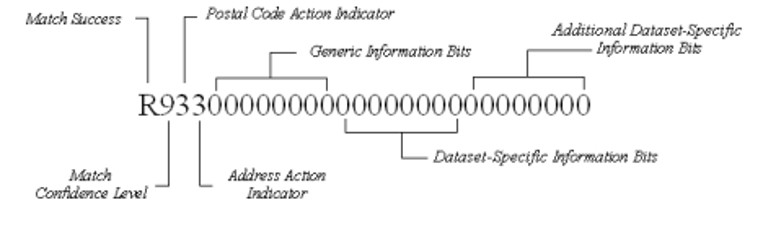

# Processing and linkage to place-based datasets 

>Last modified: 29 Oct 2026

<strong>UK LLC securely links study participants’ addresses with environmental data using a method that keeps personal and location data separate.</strong>
  
 
UK LLC facilitates the linkage of place-based datasets to participant records within the Trusted Research Environment (TRE), subject to study permissions and participant preferences.

Linked datasets include environmental exposure estimates generated by trusted partners, as well as publicly available sources describing socio-economic conditions, housing characteristics, neighbourhoods and local environmental factors.

## Linkage process

**Figure 1.** Overview of the flow of place-based data into the UK LLC TRE.

Longitudinal Population Studies (LPS) retain control over which datasets their participants' data may be linked to through UK LLC. All participant objections and linkage preferences communicated by the contributing LPS are respected and applied when undertaking linkage activities.

To ensure that linkage activities reflect the most up-to-date participant permissions, LPS provide quarterly updates of Participant Identifiable Data to UK LLC's Trusted Third Party (Digital Health and Care Wales, DHCW). These updates include participant identifiers and associated permission flags, enabling linkage activities to be undertaken only where the appropriate permissions are in place.

Find out more about the place-based permission flags

- Longitudinal Population Studies (LPS) can provide quarterly updates to the Department of Health and Care Wales (DHCW) containing participant identifiers and permission flags. These updates communicate changes to participant preferences, including opting in to or out of UK LLC and opting in to or out of linkage to place-based data.

- UK LLC uses four place-based permission flags, specified by each LPS in the participant identifier file ("File 1") provided to DHCW. These flags determine which types of place-based linkage can be undertaken:

  a. **`Geocoding_Permission`**: residential addresses can be geocoded to full address or postcode level.

  b. **`Small_Area_Permission`**: place-based information can be linked using encrypted Lower Super Output Area (LSOA) and higher-level geographic indicators.

  c. **`Environment_Permission`**: environmental datasets describing the natural and built environment can be linked.

  d. **`Property_Level_Permission`**: property-level datasets can be linked.

**Examples of permissions required for specific datasets**

| Dataset | Required permissions | Description |
|----------|----------|----------|
| **Air pollution** | A, C, D | Residential addresses are geocoded and linked to nationally modelled spatial exposure estimates. |
| **Energy Performance Certificates (EPCs)** | A, C, D | UK LLC derives Unique Property Reference Numbers (UPRNs) from addresses and links these to property-level certificate records. |
| **Access to Healthy Assets and Hazards (AHAH)** | B, C | This dataset is available at Lower Super Output Area (LSOA) level and describes features of the natural and built environment. LSOAs can be derived from routine NHS records where permissions allow. |
| **Index of Multiple Deprivation (IMD), Urban/Rural Classification and Population Density** | B, C | These measures are available at LSOA level (or equivalent) and can be derived from routine NHS geographic information where permissions allow. |
| **Live Births** | B | This dataset is available at Local Authority level, which can be derived from routine NHS geographic information. |

## Environmental exposure estimates

UK LLC works with trusted partners, including the University of Leicester and City St George's, University of London, who create environmental exposure estimates for research.

These estimates combine information from environmental monitoring systems with other data sources, such as traffic counts and weather patterns, to model exposures including air pollution, noise and access to green space. Where study permissions and participant preferences allow, these estimates are linked to participant records within the UK LLC TRE.

To create these measures, trusted partners receive address or postcode information solely to identify a participant's residential location and assign relevant environmental characteristics. They do not receive information identifying individuals or their participation in a Longitudinal Population Study (LPS).

To further protect privacy, randomly selected UK addresses are included alongside study addresses during the linkage process. This means trusted partners cannot determine which addresses belong to study participants.

Find out more about the environmental exposure linkage process

- LPS provide participant identifiers and permission flags to the Department of Health and Care Wales (DHCW). DHCW applies participant preferences and creates encrypted linkage identifiers, ensuring that participants who have opted out of UK LLC or specific place-based linkages are excluded from processing.

- Acting as a trusted linkage broker, DHCW provides approved place-based partners with only the information required to create environmental exposure estimates. This consists of address or postcode information and encrypted linkage identifiers, without information identifying individuals or their participation in an LPS.

- Address data provided to place-based partners include both participant addresses and randomly selected "masking" addresses. This additional protection means that partners cannot determine which addresses belong to study participants.

- Place-based partners use address information to derive environmental characteristics and exposures associated with residential locations, such as air pollution, environmental noise, access to services and availability of green space.

- The resulting datasets contain derived environmental measures and encrypted linkage identifiers only. These de-identified data are sent to Swansea University for re-encryption of the linkage identifiers and ingested into the UK LLC TRE.

- Additional disclosure control and Quality Control checks are made. The data are then added to the UK LLC database, documented, and made available for research.

Find out more about how participant addresses were geocoded

- Depending on the permissions available for a participant, exposures were assigned using either a full-address geocoding file or a postcode-based geocoding file.

- The software used to geocode the dataset was the Experian QAS Batch API. The QAS Batch API software geocodes address records by verifying them against the official postal address files for the relevant country. Cleaned records are then assigned a match result based on the accuracy of the original address.

- The Address matching process consists of five stages:

**Stage 1:Pre-process address**
Baselines address are imported as a CSV standard format. Address records are submitted as a single line, with individual elements separated by commas. The Encoded anonymised participant ID and Postcode fields were type specified as ‘REFERENCE’ and ‘POSTCODE’ when inputting the CSV attributes to ensure that the fields occurred in the same order as the input CSV. 
The output columns for the returned address are also specified during this stage. To note, the outputs will be returned in the following order as a string type along with the original CSV inputs. The output columns specified include:

| Variable | Description |
|----------|-------------|
| Encoded anonymised participant ID (Reference) | The ID code provided by [DATA PROVIDER]. |
| \<Auto\> | Automatically generated field. |
| \<Auto\> | Automatically generated field. |
| \<Auto\> | Automatically generated field. |
| Town English | Town name (e.g. "London"). |
| Administrative Area English | The local government subdivision in which an address is located. This may be a county, London borough, or unitary authority. |
| Postcode | Full postcode. |
| BLPU Easting | Easting (British National Grid) coordinate of the BLPU (Basic Land and Property Unit) in metres (1 cm resolution). Only produced for verified addresses. |
| BLPU Northing | Northing (British National Grid) coordinate of the BLPU (Basic Land and Property Unit) in metres (1 cm resolution). Only produced for verified addresses. |
| Matchcode | Indicates the nature of processing undertaken and any changes made to the address record (see Matchcode definitions below). |

**Stage 2: Match Country**
Once formatting is complete, QAS batch tries to identify the country that the input address relates to. Does this by matching the contents of the last two lines against a list of countries. If there is not match, batch api will mark the address as ‘Country not available’

**Stage 3: Match Street, Organisation, PO Box and Place**
Batch goes onto to match Street, Organisation, PO Box and Place. Rd and Ave are expanded to aid analysis

**Stage 4: Match Premises**
At this stage, QAS batch has matched the input address as far as the street. After match a place, was compares the property information in the input address against all the premises in the dataset for that street. If no match is achieved, the input address is marked as ‘partial address found’.

**Stage 5: Select Best match**
QAS bath API now retrieves the full verified address and assigns it a ‘quality’ score by comparing it with the original input address. During this stage, QAS evaluates a number of matching rules and assigns them a match score. If there is one or more matches, these as verified as ‘multiple matches’.

**Figure 2.** Summary diagram of the QAS Batch API process.

For more information on each stage, visit the: [QAS Batch API Guide](https://www.edq.com/globalassets/documentation/bat_api.pdf)

Find out more about the match success and confidence level of the geocoding

- The environmental exposure datasets contain a *matchcode* variable which indicates how successfully the Experian geocoding software was able to match the address. The *matchcode* also contains an indicator for confidence and whether any actions took place to correct postcode or address elements during the geocoding process. For full documentation on how to interpret the Experian *matchcode* see the <a href="https://docs.experianaperture.io/address-validation/batch-api/api-process/address-match-codes/#k-s~match-success" target="_blank" rel="noopener noreferrer">Experian documentation</a>.

**Figure 3.** Diagram presenting a full match code.

- The letter at the beginning of the match code indicates how successfully QAS Batch API was able to match your input address in an Experian Data Quality datasets. Letters ‘A – D’ denote that the input address was not processed, whereas letters ‘K – S’ denote that the input address was processed. 

- The match quality is then indicated by the following letter returned: 0 (low confidence), 5, (intermediate confidence) and 9 (high confidence).

- If QAS Batch API returns a Q or R match, along with a match confidence level of 9, you can be confident that it has found the right match.

- R9 matches are accepted automatically for both business and residential data. These equate to verified and good full match types in the batch reports.

- Batch may still return an R9 match code (indicating a full address match with high confidence) even if a UPRN match has not been found, or does not match the supplied data. If this occurs the UPRN supplied extended information will be returned as part of the match code. 

Find out more about the accuracy and completeness of the geocoding process

- In February 2023, environmental exposure modellers from the University of Leicester, Centre for Environmental Health and Sustainability were provided with either the full address level information or postcodes of participants from 7 Longitudinal Population Studies (ALSPAC, BIB, EXCEED, NIHRBIO_COPING, NSHD46, SABRE, TWINSUK) depending on the permitted linkage permissions. Details of this process can be found under the "Find out more about the environmental exposure linkage process" dropdown section above.

**Geocoding of addresses where full address was provided**:

The Experian QAS Batch API used for geocoding returned 299,301 geocoded address records out of 329,766 addresses within ~12minutes. 290,758 addresses (88.2%) classified as ‘Verified Correct’ or ‘Good’ matches. These matches suggest that there is a high level of confidence that the match address is correct, or the input data was fully accurate.

- Other address processing results by QAS Batch API are as follows:
 * 1.4% of addresses received a Good Premise Partial match.
 * 2.7% of addresses received a Tentative match.
 * 0.8%, 0.1% and 0.2% addresses received a partial, poor or had multiple matches.
 * 0.0% of addresses were matched as foreign addresses
 * 6.6% of addresses were unmatched

 **Geocoding of addresses where only postcodes were provided**:

In total, QAS Batch API returned 241,342 address records out of 477,668 addresses within ~14minutes. No addresses were classified as ‘Verified Correct’ or ‘Good’ matches. These matches suggest that there is a high level of confidence that the match address is correct, or the input data was fully accurate. All addresses received either a poor, multiple, and partial match with low confidence. 

- Other address processing results by QAS Batch API are as follows:
 * 51.6% of addresses received a Poor match.
 * 10.5% of addresses received a Multiple match.
 * 0.7% of addresses received a Partial match.
 * 0.0% of addresses were matched as foreign addresses
 * 37.2% of addresses were unmatched

It would be difficult to manually clean this address file since no address lines are provided for comparison.

## Public domain datasets

UK LLC collates and processes publicly available datasets relating to a participants' residential property and neighbourhood (for example, at Lower Super Output Areas or Unique Property Reference Number level) for inclusion within the UK LLC TRE.

These data are obtained from public sources and are processed before inclusion in UK LLC TRE to ensure they are de-identified and appropriate for research use. Public domain datasets are managed in line with UK LLC's decision-making framework, which recognises that anonymisation is context-dependent and balances data utility with privacy considerations. This framework informs the controls and transformations applied to variables before they are made available to researchers.

Find out more about the linkage process for public domain datasets

- UK LLC can link to public domain geographic datasets at Lower Super Output Area (LSOA) level or equivalent or higher level geographies such as Middle Super Output Area (MSOA).

- These datasets are obtained from open sources or through data-sharing agreements with third-party organisations.

- Before inclusion in the UK LLC TRE, datasets undergo data quality checks, disclosure risk assessment and, where necessary, transformations to reduce the risk of identifying a real-world property or location while preserving their value for research.

- Where data are available at LSOA level (or equivalent) or higher geographic levels, the geographic identifiers are encrypted and linked to participants using corresponding encrypted geographic identifiers held within the TRE.

- Where data are available at Unique Property Reference Number (UPRN) level, they are processed through the same secure linkage pathway used for partner-generated datasets. This enables property-level characteristics to be linked while maintaining participant confidentiality.

## Place-based data in the UK LLC TRE

All geographic indicators below the level of English region and devolved nation are encrypted before being ingested into the UK LLC TRE. These encrypted identifiers cannot be reversed by UK LLC staff or researchers and provide a consistent way to undertake clustered and multi-level analyses, from individual properties and households through to neighbourhoods and larger geographic areas.

UK LLC makes available 12 broad geographies for analysis and reporting: the nine English regions, alongside Scotland, Wales and Northern Ireland. These geographies support comparative research and policy analyses across the four UK nations.

Public domain place-based datasets undergo disclosure-control assessment before they are made available within the TRE. These assessments balance the need to protect confidentiality whilst maintaining the usefulness of the data for research.

Find out more about disclosure control and risk assessment

Before a place-based dataset is added to the TRE, UK LLC assesses whether it could inadvertently reveal information about a specific property or location. Potential disclosure risks vary between datasets, but may include situations such as:

- Changes over time that could make properties or locations identifiable, for example through the construction or demolition of buildings.

- Patterns that could reveal specific types of locations, such as care homes, prisons, student accommodation or small islands.

- Unusual characteristics that could identify individual buildings, such as a unique height, size or use.

- Date-related information that could be linked to events associated with a property or household, such as residential moves.

- Geographic areas with a distinctive combination of characteristics that could make them readily recognisable.

- Changes in geographic boundaries over time that could increase the risk of identifying a location.

These examples are illustrative and form part of a broader assessment of disclosure risk undertaken before data are made available for research.

### Balancing research utility and disclosure risk

UK LLC's risk assessment process aims to reduce the possibility of spontaneous recognition of places or participants while maintaining the value of the data for research.

Where necessary, variables are transformed using disclosure-control techniques such as aggregation. The specific approach used for each variable is selected to preserve as much analytical utility as possible while reducing disclosure risk.

The usefulness of transformed variables is assessed throughout this process. Risk assessments are reviewed whenever datasets are updated, enabling UK LLC to continually refine the balance between privacy protection and research utility.

