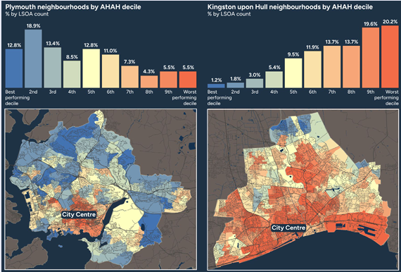

# Using the AHAH index to understand the links between health and place

## DRAFT 
Published: dd mmm 2026

<strong>By Mark Green, Professor of Health Geography, University of Liverpool, December 2026.</strong>
  

## Introduction 
Our health is shaped not only by individual circumstances and behaviours, but also by the neighbourhoods in which we live. Access to green space, local health services and other amenities can create opportunities for healthier lives, while exposure to environmental hazards may present challenges. Understanding these neighbourhood differences is important for explaining health inequalities and identifying opportunities to improve population health.  

The **Access to Healthy Assets and Hazards (AHAH)** index provides researchers with a way to investigate these relationships. Developed by the <a href="https://geods.ac.uk/" target="_blank" rel="noopener noreferrer">Geographic Data Science (GDS)</a> team and linked into the UK LLC Trusted Research Environment (TRE), AHAH measures health-related features of neighbourhood environments across Great Britain.  

## What does AHAH measure?
AHAH brings together indicators across four domains: 

•	**Retail environment:** access to features such as fast-food outlets, pubs and bars, tobacconists and gambling outlets.  

•	**Health services:** accessibility of GPs, hospitals, pharmacies, dentists and leisure centres.  

•	**Green and blue space:** access to greenspace and blue space, alongside measures of vegetation derived from satellite imagery.  

•	**Air quality:** exposure to pollutants including nitrogen dioxide (NO2), particulate matter (PM10) and sulphur dioxide (SO2).

>These indicators are combined into an overall index score, providing a summary measure of how healthy or unhealthy a neighbourhood environment is. 

AHAH is an open-source resource where all of the individual indicators and domain scores can be freely downloaded via the <a href="https://data.geods.ac.uk/dataset/access-to-healthy-assets-hazards-ahah" target="_blank" rel="noopener noreferrer">Geographic Data Service data portal</a>.  See Figure 1 (below) for examples.

  

**Figure 1:** Access to Healthy Assets and Hazards presented as deciles for Plymouth and Kingston upon Hull, 2021. Source: <a href="https://data.geods.ac.uk/dataset/8fa47a8b-345c-438d-a8c3-0ac758ee12be/resource/5a35a0cd-3984-4cfd-ba5a-8d9f35b37402/download/ahah-2026-web-new.pdf" target="_blank" rel="noopener noreferrer">GDS data portal</a> 

## Why link AHAH to longitudinal studies?
Linking neighbourhood-level environmental data with longitudinal studies helps researchers bring together perspectives from **public health, geography, epidemiology and social science**. It also makes it easier to investigate place as one part of the wider set of circumstances shaping people's lives.  

<a href="https://www.sciencedirect.com/science/article/pii/S1353829218303563" target="_blank" rel="noopener noreferrer">Prior research</a> has showed that the AHAH index has a stronger association to mental health than physical health. Replicating this work in wider datasets, seeing if it is consistent for different subsets of the population, or studying the pathways for why represents an important research area. 

The longitudinal perspective is especially important and something that UK LLC data are well positioned to answer. Rather than examining differences between people at a single point in time, researchers can investigate how **environmental circumstances through AHAH relate to health trajectories** and outcomes captured through repeated surveys and linked electronic health records. Such longitudinal research is novel and needed across the health geography literature.  

>We would also be open to studies which critique or challenge AHAH and how it could be used in longitudinal data analyses, something that linked data would contribute towards. 

AHAH can also have value beyond being an exposure of interest. It could also act as a control variable in analyses which are trying to capture the influence of the built environment on their areas of interest (e.g., as a confounder). 

Overall, there is a lot of value that AHAH linked into UK LLC brings to studying the links between health and place.

## What are the potential research areas?
UK LLC has linked 10 Longitudinal Population Studies to AHAH, creating opportunities to investigate how neighbourhood environments influence health over time. Details of which UK LLC partner LPS can be linked to AHAH can be found on this [Guidebook page](../../available_linkages/lps_actual_geographic.md). A version of the AHAH dataset containing quintiles for all indicators and domains is available to request via selection on UK LLC Explore.

Some initial first use cases of the linked AHAH dataset include:  
* Understanding environmental, demographic and social factors associated with patterns of disease diagnosis.

* Investigating how environmental exposures interact with genetic risk factors to influence health outcomes.

* Improving prediction of respiratory health risks and healthcare demand across different seasons and major public health events.

 

**These examples highlight the potential of AHAH to support research on environmental influences on health, health inequalities and long-term health trajectories.**
